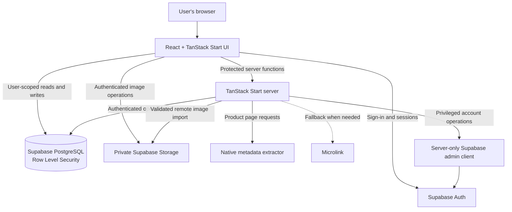

# WishList

**A private, self-hostable wishlist and purchase planner for products across different stores.**

WishList helps you save products, compare the details that matter, organize future purchases, set savings goals, and keep a record of what you buy—all within an installation backed by your own Supabase project.

Built with **React, TypeScript, TanStack Start, and Supabase**, it supports manual entry as well as best-effort product information extraction from URLs.

[Features](#features) · [Getting Started](#getting-started) · [Architecture](#architecture) · [Self-Hosting Guide](./docs/SELF_HOSTING.md) · [Contributing](./CONTRIBUTING.md)

## Preview


> The public landing page of a self-hosted WishList installation.

## Table of Contents

- [Overview](#overview)
- [Features](#features)
- [Technology Stack](#technology-stack)
- [Architecture](#architecture)
- [Repository Structure](#repository-structure)
- [Getting Started](#getting-started)
- [Environment Variables](#environment-variables)
- [Using WishList](#using-wishlist)
- [Database and Storage](#database-and-storage)
- [Product Metadata Extraction](#product-metadata-extraction)
- [Backup and Data Portability](#backup-and-data-portability)
- [Security and Privacy](#security-and-privacy)
- [Deployment](#deployment)
- [Development and Testing](#development-and-testing)
- [Limitations](#limitations)
- [Documentation](#documentation)
- [Contributing](#contributing)
- [License and Attribution](#license-and-attribution)

## Overview

Products you want to buy rarely come from one store, and a bookmark alone does not capture *why* you wanted something, *how much* you intended to spend, or *whether* you eventually purchased it.

WishList brings those decisions together in one personal workspace:

- **Save across stores:** Keep product links and manually entered items together.
- **Organize with context:** Add categories, collections, priorities, notes, and reasons for wanting an item.
- **Plan purchases:** Set budgets and dates, record money saved, and review progress.
- **Track decisions:** Separate items you're considering, saving for, ready to buy, or have purchased or rejected.
- **Keep control of your deployment:** Configure your own Supabase authentication, database, and private image storage.

WishList is designed for self-hosting rather than relying on a shared account with the repository maintainer. Each installation uses its own infrastructure and configuration.

## Features

| Area | Capabilities |
| --- | --- |
| **Wishlist management** | Create, view, edit, search, archive, restore, and delete products. |
| **Product links** | Save source and canonical URLs; attempt to extract product titles, prices, brands, images, ratings, and other available metadata. |
| **Organization** | Create categories and reusable collections; place one item in multiple collections. |
| **Discovery and filtering** | Filter the dashboard by category, collection, priority, status, store, or currency; sort items and switch between grid and list views. |
| **Purchase planning** | Set target budgets and purchase dates, record amounts saved, and view savings progress. |
| **Purchase records** | Mark items as purchased and record purchase date, actual price, and reflections. |
| **Price information** | Store current and original prices and view recorded price history. |
| **Images** | Upload JPEG, PNG, or WebP images; import supported remote images into private storage when possible. |
| **Account preferences** | Choose a default currency, theme, and dashboard view. |
| **Data portability** | Export JSON backups or CSV item lists; import supported JSON backups in merge or replace mode. |
| **Authentication** | Sign up and sign in with email/password; optionally enable Google OAuth through Supabase. |

### Item lifecycle

WishList keeps the item's **status** separate from whether it is **archived**.

The supported statuses are `considering`, `wanted`, `saving`, `ready_to_buy`, `purchased`, and `rejected`. Purchased items have their own view, while archived items can be restored or permanently deleted. This distinction helps retain purchase history without mixing completed decisions into the active wishlist.

### Categories and collections

**Categories** provide a primary way to classify items. **Collections** provide flexible, many-to-many grouping—for example, a desk setup, travel essentials, or a future upgrade plan. Collections can include descriptions, target dates, and budgets without moving items out of their categories.

### Planning across currencies

Items can store supported currencies independently. The dashboard groups monetary totals by currency instead of incorrectly combining amounts denominated in different currencies.

## Technology Stack

| Layer | Technology | Purpose |
| --- | --- | --- |
| Language | TypeScript | Typed application and domain logic |
| UI | React 19 | Interactive application interface |
| Full-stack framework | TanStack Start | Application rendering and server functions |
| Routing | TanStack Router | File-based navigation and layouts |
| Data fetching | TanStack Query | Client-side queries, mutations, and caching |
| Build and styling | Vite 8, Tailwind CSS v4 | Tooling, bundling, and styling |
| UI components | Radix UI primitives, Lucide icons | Accessible interface primitives and iconography |
| Authentication | Supabase Auth | User accounts, sessions, and optional Google OAuth |
| Database | Supabase PostgreSQL | Persistent wishlist records and relationships |
| File storage | Supabase Storage | Private item images and signed image URLs |
| Metadata extraction | Native extraction with Microlink fallback | Best-effort product metadata retrieval |
| Deployment | Nitro (Vercel preset) | Server deployment output |
| Testing | Vitest, jsdom, React Testing Library | Automated tests |

For authoritative dependency versions, refer to [`package.json`](./package.json).

## Architecture

WishList uses a React frontend with TanStack Start server functions and a Supabase-backed data layer.



**How the layers interact**

1. The browser handles the dashboard, forms, navigation, and authenticated Supabase client operations.
2. Supabase Auth manages identities and sessions.
3. PostgreSQL Row Level Security (RLS) policies and ownership checks control access to user-owned records.
4. Private Supabase Storage stores item images under user-scoped paths; the application uses signed URLs to display stored images.
5. Authenticated TanStack Start server functions perform operations such as product extraction, remote image import, and account deletion.
6. The native extractor reads publicly accessible product-page metadata. Microlink can be used as a fallback when the native result is incomplete or fails.

See [Architecture](./docs/ARCHITECTURE.md) for a more detailed technical reference.

## Repository Structure

```text
WishList/
├── docs/                         # Architecture, setup, security, and deployment guides
│   └── assets/
│       └── wishlist-preview.png   # Existing README preview image
├── public/                       # Static public assets
├── src/
│   ├── components/               # Application shell, forms, cards, shared UI
│   │   └── ui/                   # Reusable UI primitives
│   ├── hooks/                    # Reusable React hooks
│   ├── integrations/
│   │   └── supabase/             # Supabase clients, auth middleware, types
│   ├── lib/                      # Domain logic, queries, backups, image handling
│   │   ├── extraction/           # Native extraction, fallback, merging, image import
│   │   └── __tests__/            # Automated application tests
│   ├── routes/                   # TanStack Router file-based routes
│   ├── test/                     # Test setup
│   └── styles.css                # Application styles
├── supabase/
│   └── migrations/               # Versioned database and storage changes
├── .env.example                  # Environment variable template
├── package.json                  # Dependencies and npm scripts
├── vite.config.ts                # Vite, TanStack Start, and Nitro configuration
├── vitest.config.ts              # Test configuration
├── CONTRIBUTING.md               # Contribution instructions
├── SECURITY.md                   # Security and disclosure guidance
└── README.md
```

The authenticated application routes implement the dashboard, item creation and detail views, categories, collections, purchased items, archived items, and settings. Route definitions are under [`src/routes/`](./src/routes/).

## Getting Started

> [!IMPORTANT]
> Installing dependencies and running the development server is not enough for authenticated features. You must also configure **your own Supabase project** and apply the repository's database migrations. The [self-hosting guide](./docs/SELF_HOSTING.md) is the canonical end-to-end setup reference.

### Prerequisites

- Git
- Node.js: a current active LTS release compatible with the project's dependencies
- npm (the repository uses `package-lock.json`)
- A [Supabase](https://supabase.com/) account and project
- A [Vercel](https://vercel.com/) account **only if** deploying to Vercel
- A Google Cloud project **only if** enabling optional Google OAuth

### 1. Clone the repository

```bash
git clone https://github.com/YellankiKaushik/WishList.git
cd WishList
```

### 2. Install dependencies

```bash
npm install
```

### 3. Configure local environment variables

On macOS or Linux:

```bash
cp .env.example .env.local
```

On Windows PowerShell:

```powershell
Copy-Item .env.example .env.local
```

Populate `.env.local` with credentials from **your own** Supabase project:

```dotenv
# Browser-accessible Supabase configuration
VITE_SUPABASE_URL=https://YOUR_PROJECT_REF.supabase.co
VITE_SUPABASE_PUBLISHABLE_KEY=YOUR_PUBLISHABLE_KEY

# Server-only Supabase configuration
SUPABASE_URL=https://YOUR_PROJECT_REF.supabase.co
SUPABASE_PUBLISHABLE_KEY=YOUR_PUBLISHABLE_KEY
SUPABASE_SECRET_KEY=YOUR_SECRET_KEY

# Optional metadata provider key
MICROLINK_API_KEY=
```

**Never commit `.env.local` or real credentials.** The `VITE_` prefix exposes a variable to browser code; never use it for a secret key.

### 4. Set up the database

The Supabase CLI is included in the project's development dependencies.

```bash
npx supabase login
npx supabase link --project-ref YOUR_PROJECT_REF
npx supabase migration list
npx supabase db push --dry-run
npx supabase db push
```

Review the dry-run output before applying migrations. The migrations establish the application's database structures, access policies, and storage configuration.

Configure email authentication and the appropriate local redirect settings in Supabase. See [Authentication Setup](./docs/AUTH_SETUP.md) and [Self-Hosting](./docs/SELF_HOSTING.md).

### 5. Start the application

```bash
npm run dev
```

Open the URL printed by Vite, typically:

**http://localhost:5173**

Create an account, sign in, and start building your wishlist. If your terminal shows a different port, use that URL and update your Supabase redirect settings accordingly.

## Environment Variables

| Variable | Exposure | Required | Description |
| --- | --- | --- | --- |
| `VITE_SUPABASE_URL` | Browser | Yes | URL of your Supabase project. |
| `VITE_SUPABASE_PUBLISHABLE_KEY` | Browser | Yes | Publishable key for browser-side Supabase requests. |
| `SUPABASE_URL` | Server | Yes | Supabase project URL used by server functions. |
| `SUPABASE_PUBLISHABLE_KEY` | Server | Yes | Publishable key used by authenticated server operations. |
| `SUPABASE_SECRET_KEY` | **Server only** | Yes for full functionality | Privileged Supabase key used for admin operations, including account deletion. |
| `MICROLINK_API_KEY` | **Server only** | No | Optional key for the Microlink metadata fallback. |

These are the variables in [`.env.example`](./.env.example). Legacy server-side service-role key compatibility exists for older deployments, but new installations should follow the current secret-key configuration.

**Security boundary:** A Supabase publishable key is intended to be public; isolation depends on correct database RLS and storage policies. A Supabase secret key is privileged and must never be placed in a `VITE_` variable.

## Using WishList

### Add an item

1. Sign in and open the dashboard.
2. Choose to add an item.
3. Paste a product URL and attempt extraction, or enter details manually.
4. Review the preview and edit anything missing or incorrect.
5. Set a category, collections, priority, budget, or target purchase date.
6. Save the item to your wishlist.

The app also normalizes product URLs to help identify previously saved links.

### Organize and review

Use dashboard search and filters to find products by relevant attributes. Switch between grid and list views, sort by price or priority, and use categories and collections to group related plans.

### Track a purchase

On an item, review its savings progress and any recorded price history. When you buy it, mark it as purchased and optionally record the actual price, purchase date, and a reflection. Purchased items remain accessible in their dedicated view.

### Manage your data

The settings page supports preferences, JSON/CSV export, JSON import, and account-management actions. See [Backup and Data Portability](#backup-and-data-portability) before relying on a backup for migration or recovery.

## Database and Storage

Application data is stored in Supabase PostgreSQL. The repository's migrations define and maintain these key tables:

| Table | Role |
| --- | --- |
| `profiles` | User preferences and profile information |
| `categories` | User-defined item categories |
| `collections` | Named groups with optional planning details |
| `items` | Product metadata, priorities, statuses, budgets, and purchase records |
| `item_collections` | Many-to-many relationships between items and collections |
| `item_images` | Image metadata and storage references |
| `price_history` | Recorded price snapshots |
| `extraction_logs` | Metadata-extraction attempts and provider diagnostics |

### Private image storage

WishList uses a private bucket named `item-images` with paths scoped to the authenticated user and item:

```text
<user-id>/<item-id>/<filename>
```

Supported upload formats are **JPEG, PNG, and WebP**, with a **10 MB** upload limit. The client also supports image compression before upload. Stored private images are accessed through signed URLs.

### Database changes

Create **new migration files** for schema changes. Do not edit migrations already applied to a deployed project.

For complete instructions, see [Database Setup](./docs/DATABASE_SETUP.md) and [Storage Setup](./docs/STORAGE_SETUP.md).

## Product Metadata Extraction

WishList uses a best-effort, native-first extraction pipeline for product URLs.

1. **Native extraction:** The server requests a publicly accessible product page and checks structured metadata such as JSON-LD, Open Graph, Twitter cards, schema.org fields, and relevant HTML.
2. **Optional fallback:** When the native result fails or lacks sufficient information, a Microlink-based provider may supplement it.
3. **Result merging:** The application combines provider results, ranks image candidates, and returns extracted details for review.
4. **Image handling:** Where possible, a validated remote image is imported into private Supabase Storage.
5. **Manual correction:** Users can edit or fill in every relevant field before saving.

The extractor includes URL validation and limits on redirects, response sizes, and request duration. These protections reduce risk but do not guarantee that every website will be extractable.

**Extraction is not guaranteed.** CAPTCHA, login walls, anti-bot measures, rate limits, protected image hosts, JavaScript-only product pages, and incomplete public metadata can prevent or limit results.

Microlink is optional and may have its own rate limits or pricing. See [`src/lib/extraction/`](./src/lib/extraction/) for the implementation.

## Backup and Data Portability

WishList provides:

- **JSON export:** Download a structured backup of application records associated with your account.
- **CSV export:** Download item information for use in spreadsheets.
- **JSON import:** Restore supported backups using **merge** or **replace** mode.
- **Legacy compatibility:** The importer accepts the `wishlist-backup` format and the older `aspirelist-backup` format.

Imports validate the supported format and associate imported user-owned rows with the account performing the import. **Replace mode can delete existing records**; review the confirmation carefully.

> [!NOTE]
> The JSON export collects database records and image metadata. It should **not** be assumed to contain the binary files from private Supabase Storage. If you are migrating instances or planning disaster recovery, back up the storage objects separately and verify that their references remain valid.

## Security and Privacy

WishList's self-hosting model allows each installation to use separate authentication, database, and storage resources.

The implementation includes:

- **Authentication:** Supabase Auth with email/password and optional Google OAuth.
- **Database access controls:** RLS policies on application tables, with user-ownership checks.
- **Relationship integrity:** Database checks that prevent cross-user associations.
- **Private images:** User-scoped Supabase Storage policies and signed URLs.
- **Protected server functions:** Authenticated operations for extraction and privileged account actions.
- **Secret separation:** Server-side credentials remain outside browser-prefixed environment variables.
- **Network-request protections:** Validation and limits for product page fetching and remote image imports.

Self-hosting does not remove third-party dependencies. The application still communicates with your configured infrastructure and may request external product pages or use Microlink during extraction.

**Before using a deployment with real data, perform the second-user isolation test** documented in the [post-deployment checklist](./docs/POST_DEPLOY_CHECKLIST.md).

To report a vulnerability, follow [SECURITY.md](./SECURITY.md). Do not disclose sensitive credentials or private user data in public issues.

## Deployment

The repository is configured for **Vercel** using Nitro's Vercel preset. The build generates Vercel Build Output API artifacts under `.vercel/output`.

A typical deployment flow is:

1. Fork or clone the repository into your own GitHub account.
2. Create and configure your own Supabase project.
3. Apply the database migrations.
4. Import the repository into Vercel.
5. Configure the required environment variables for the deployment.
6. Run the project build and deploy.
7. Update the Supabase Auth site URL and allowed redirect URLs to match your production domain.
8. Configure Google OAuth only if you intend to offer it.
9. Verify login, data operations, image storage, and user isolation.

For precise build settings and production configuration, use:

- [Full Self-Hosting Guide](./docs/SELF_HOSTING.md)
- [Vercel Deployment Guide](./docs/VERCEL_DEPLOYMENT.md)
- [Post-Deployment Checklist](./docs/POST_DEPLOY_CHECKLIST.md)
- [Troubleshooting](./docs/TROUBLESHOOTING.md)

**Public demo:** No shared public demo is linked in this repository. You can run your own installation using the guides above.

## Development and Testing

### npm scripts

| Command | Description |
| --- | --- |
| `npm run dev` | Start the local Vite development server |
| `npm run build` | Create a production build |
| `npm run build:dev` | Build using development mode |
| `npm run preview` | Preview the built application |
| `npm run typecheck` | Run TypeScript checks without emitting files |
| `npm run lint` | Run ESLint |
| `npm run test` | Execute the Vitest test suite |
| `npm run format` | Format the repository using Prettier |

### Recommended checks

Run the project's validation commands before submitting changes:

```bash
npm run typecheck
npm run test
npm run lint
npm run build
npm audit
```

Tests cover selected domain helpers, item payload behavior, backup validation, product extraction, fallback merging, image candidates, retry behavior, and image import validation. Test coverage is not a substitute for verifying live Supabase and deployment behavior.

### Engineering conventions

- Use **npm** and keep `package-lock.json` consistent with dependency changes.
- Keep secrets and generated output out of source control.
- Add new Supabase migrations instead of rewriting applied migration history.
- Do not manually edit the generated TanStack Router route tree.
- Follow [`AGENTS.md`](./AGENTS.md) and [`CONTRIBUTING.md`](./CONTRIBUTING.md) for repository-specific practices.

## Limitations

- **Metadata extraction is best-effort:** Some shopping sites cannot be read automatically.
- **External services require configuration:** Authenticated features depend on your Supabase project, and Vercel is the documented deployment target.
- **Google OAuth is optional:** It requires additional configuration in Supabase and Google Cloud.
- **Remote image imports may fail:** Unsupported formats, oversized files, blocked hosts, and network errors can prevent copying images into storage.
- **Price information is not guaranteed to be live:** Saved values and recorded history should not be interpreted as continuous cross-store price monitoring.
- **JSON backup is not a full infrastructure snapshot:** Preserve storage objects and infrastructure configuration separately.
- **Provider quotas and pricing can change:** Check the current limits of Supabase, Vercel, Google, and Microlink when planning a deployment.

## Documentation

| Guide | Description |
| --- | --- |
| [Documentation Index](./docs/README.md) | Entry point for all project documentation |
| [Self-Hosting](./docs/SELF_HOSTING.md) | Complete setup and deployment walkthrough |
| [Architecture](./docs/ARCHITECTURE.md) | System components and data flow |
| [Authentication Setup](./docs/AUTH_SETUP.md) | Supabase authentication setup |
| [Google OAuth Setup](./docs/GOOGLE_OAUTH_SETUP.md) | Optional Google sign-in configuration |
| [Database Setup](./docs/DATABASE_SETUP.md) | Database preparation and migrations |
| [Storage Setup](./docs/STORAGE_SETUP.md) | Private image storage configuration |
| [Vercel Deployment](./docs/VERCEL_DEPLOYMENT.md) | Hosting and production configuration |
| [Post-Deployment Checklist](./docs/POST_DEPLOY_CHECKLIST.md) | Functional and security verification |
| [Troubleshooting](./docs/TROUBLESHOOTING.md) | Common setup and operational issues |
| [Security Policy](./SECURITY.md) | Security expectations and vulnerability reporting |
| [Contributing](./CONTRIBUTING.md) | Contributor workflow |

## Contributing

Contributions are welcome. Review [CONTRIBUTING.md](./CONTRIBUTING.md) before opening a pull request.

Keep changes focused, describe the behavior they affect, add or update tests where appropriate, and run the documented validation commands. Never include production credentials in issues, commits, or pull requests.

## License and Attribution

WishList is distributed under the **MIT License**. See [LICENSE](./LICENSE) for the full terms and copyright notice.

**Original author and copyright holder:** [Yellanki Kaushik](https://github.com/YellankiKaushik)

**Source repository:** [YellankiKaushik/WishList](https://github.com/YellankiKaushik/WishList)

If you fork or adapt this project, retain the original copyright and license notice as required by the MIT License.
